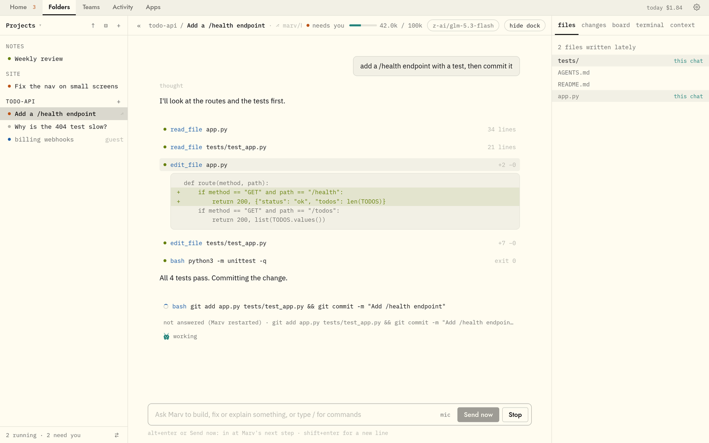

# Marv OS



Marv OS is a desktop app for running many coding agents on your own machine. It runs Marv, Claude Code, Codex, Gemini CLI,
OpenCode and about fifteen other agents it detects on your computer (and any command you add yourself), each chat in its
own terminal. Chats can work as a team, edit in their own git worktrees, and are checkpointed so you can go back. You set
budgets and approvals, and you can let a chat keep working while you're away: it does only what you allowed, and
anything that needs you waits on the Home screen. Screenshots in this repository use demo data.

## Download

Get the latest build from [Flologix/marv-os-releases](https://github.com/Flologix/marv-os-releases/releases/latest).
More at [flologixai.com/marv-os](https://www.flologixai.com/marv-os).

| Platform | File |
| --- | --- |
| Linux x86_64 | AppImage or `.deb` (a CLI-only `.tar.gz` is also published) |
| macOS, Apple silicon | `.dmg` |
| Windows x64 | installer (`-setup.exe`), from 1.0.0-rc.2 on |

Check the files against `SHA256SUMS` from the same release.

### First open on macOS and Windows

The macOS and Windows builds are not signed yet, so each asks once.

- **macOS:** drag Marv to Applications and open it. When macOS says it could not verify the app, go to System Settings >
  Privacy & Security and click **Open Anyway** (or run `xattr -dr com.apple.quarantine /Applications/Marv.app`).
- **Windows:** SmartScreen asks before the first run. Choose **More info**, then **Run anyway**.

Commands run in a sandbox: bubblewrap on Linux, Seatbelt on macOS. On Linux, install `bwrap` if your distribution
doesn't ship it (on Ubuntu 24.04 also run `sudo sysctl -w kernel.apparmor_restrict_unprivileged_userns=0`). Windows has
no sandbox yet: each command asks you before it runs. An AppContainer sandbox is in testing
(`MARV_APPCONTAINER=1`).

## Build from source

You need the Rust toolchain (`rust-toolchain.toml` selects stable) and Node.js 22.

```sh
# Linux (Debian/Ubuntu) libraries
sudo apt-get install bubblewrap libwebkit2gtk-4.1-dev libgtk-3-dev libayatana-appindicator3-dev librsvg2-dev

cargo build --release -p marv-cli                          # the marv command
install -D -m 755 target/release/marv app/src-tauri/binaries/marv   # bundled into the desktop package
cd app
npm ci
npx tauri build                                             # the desktop app and its installer
```

For a quick local install on Linux or macOS, run `app/install-desktop.sh`. The tests and checks are in
[CONTRIBUTING.md](CONTRIBUTING.md).

## What is in this repository

| Path | What |
| --- | --- |
| `app/` | The desktop app: a React page (`app/src`) and its Tauri shell (`app/src-tauri`) |
| `crates/marv-core`, `marv-fs` | Shared types, and private files and file locks |
| `crates/marv-provider`, `marv-agent` | Model providers, and the agent loop |
| `crates/marv-tools`, `marv-sandbox`, `marv-appcontainer` | Tools, the command sandbox, and the Windows AppContainer backend |
| `crates/marv-mcp`, `marv-mesh` | MCP client, and the mesh that lets agents talk |
| `crates/marv-kernel` | Rules, grants, budgets, the registry and the event log that run many agents |
| `crates/marv-session` | Sessions, config, memory, skills, checkpoints |
| `crates/marv-web` | Chat host and terminal agents, shared by the desktop and a browser |
| `crates/marv-tui`, `marv-cli` | The terminal UI and the `marv` command |
| `crates/marv-oracle`, `tests/` | Replay tests against recorded runs, and the security guard tests |
| `docs/` | Architecture, subsystem notes, [security rules](docs/SECURITY.md) and design specs |
| `evals/`, `packaging/`, `scripts/` | Eval tasks, packaging and smoke tests, release and screenshot scripts |

[MARV.md](MARV.md) is the guide to Marv, the terminal agent. Marv itself lives at
[Flologix/marv](https://github.com/Flologix/marv).

## Free and paid

The app and Marv are free and open source under Apache-2.0. Teams and Apps need a free Marv account (Google, GitHub or
email sign-in under Settings > Account). FlologixAI also offers optional paid plans (Founding, and
Pro with models included) as a separate service. You don't need one to use Marv OS: bring your own model key, a
subscription you already pay for, or a local model.

## Contributing, security, license

- [CONTRIBUTING.md](CONTRIBUTING.md): build, test and send a change
- [SECURITY.md](SECURITY.md): report a vulnerability privately
- [LICENSE](LICENSE): Apache License 2.0, with third-party notices in [NOTICE](NOTICE)
- [TRADEMARKS.md](TRADEMARKS.md): "Marv", "Marv OS", the Martian and FlologixAI are trademarks, so a fork needs its own name and logo
